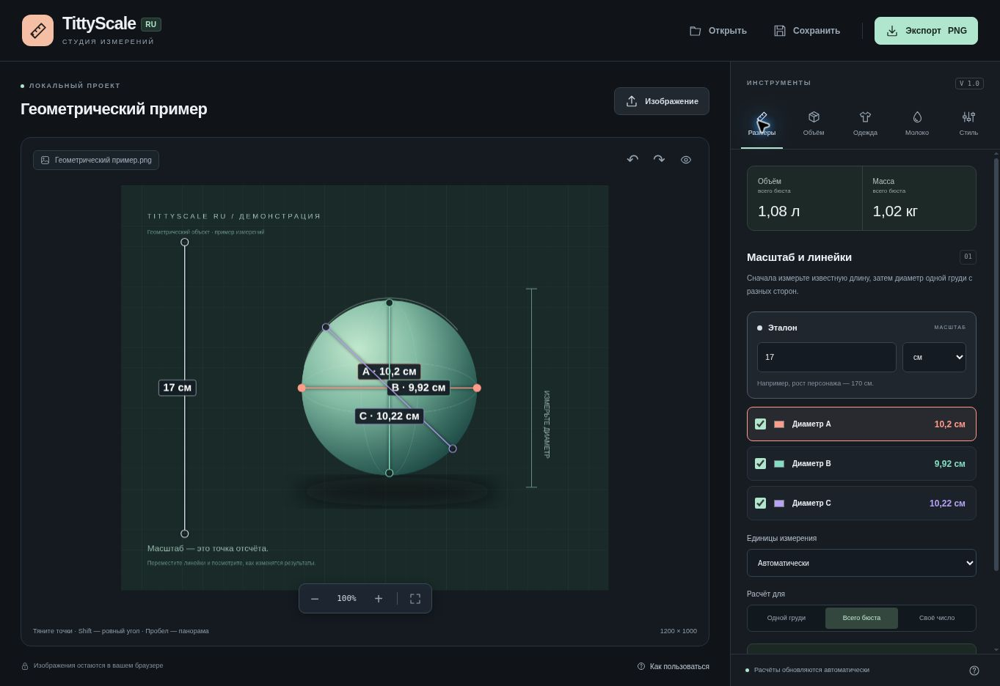

# TittyScale RU

[Открыть сайт](https://pzdrzk.github.io/tittyscaling-ru/)



Русская студия измерений по изображениям. Статический сайт для GitHub Pages: без сервера, сборки, регистрации, внешних библиотек и аналитики.

## Возможности

- Загрузка PNG, JPG, WebP, GIF, AVIF и BMP из файла, буфера обмена или перетаскиванием. Прямые ссылки работают, если сервер разрешает CORS.
- Эталонная линейка и три отключаемые линейки диаметра. Перетаскивание концов, линий и подписей; фиксация угла с Shift.
- Объём по среднему диаметру, как в оригинальной идее, или по трём осям эллипсоида. Масса, сценарий роста, единицы от миллиметров до космических масштабов.
- Расчёт для одной груди, всего бюста или заданного количества.
- Оценка дополнительной ткани, запаса на раскрой и стоимости материала.
- Условная молочная модель с настраиваемой производительностью, ценой и энергетическими эквивалентами.
- Цвета и толщина линеек, подписи, пользовательские заметки, фиксация текущих результатов.
- Масштабирование, панорама, отмена и повтор действий.
- Экспорт PNG в исходном или двойном размере, необязательная сводка, копирование PNG в поддерживаемых браузерах.
- Сохранение проекта в `.tittyscale.json` вместе с изображением, настройками и разметкой; повторное открытие проекта.
- Адаптивная компоновка и управление линейками с клавиатуры.

## Использование

1. Откройте изображение. Для знакомства доступен геометрический пример.
2. Разместите светлую линейку на известной длине и задайте значение эталона.
3. Измерьте **одну грудь** линейками A, B, C. Отключите неиспользуемые направления.
4. Посмотрите расчёты, настройте оформление и сохраните PNG или проект.

Файлы обрабатываются в браузере и не загружаются на сервер. При загрузке по URL браузер обращается к указанному серверу. Крупные изображения уменьшаются до 4096 пикселей по длинной стороне и 16 млн пикселей. У GIF и других анимаций используется один кадр. Автосохранения нет: сохраните проект перед закрытием вкладки. В экспорт не попадают ручки, выделения и интерфейс. Экспорт ограничен 8192 пикселями по стороне и 20 млн пикселей в сумме.

## Модели

Все линейки используют один масштаб, заданный эталоном. Результат зависит от перспективы, ракурса и размещения линеек.

- **Средний диаметр:** `V = π / 6 × d³ × n`, где `d` — арифметическое среднее активных диаметров, `n` — количество.
- **Эллипсоид:** `V = π / 6 × a × b × c × n`. Недостающие оси заменяются средним активных осей.
- **Масса:** `m = V × ρ`. Плотность по умолчанию — условные `0,945 г/см³`, значение можно изменить.
- **Рост:** прибавка диаметра применяется ко всем осям за выбранный выходной период; результат — разница масс.
- **Ткань:** площадь полусферы `2πr² × n`, плюс заданный процент запаса. Это дополнительный материал, без основы одежды и выкройки.
- **Молоко:** заданный процент объёма в час (по умолчанию 5%). Это фантазийная модель из оригинальной идеи, а не прогноз реальной лактации. Энергетический коэффициент — `676,281 ккал/л`, условное сравнение — `2 400 ккал/сутки` на взрослого. Цена задаётся вручную; смена валюты меняет обозначение, без конвертации.
- Месяц равен `1/12` юлианского года, год — `365,25 суток`.

## Локальный запуск и проверки

Никаких пакетов устанавливать не нужно. Для локального запуска из каталога проекта:

```sh
python3 -m http.server 8080
```

Откройте `http://localhost:8080`. ES-модули требуют HTTP(S), поэтому открытие `index.html` через `file://` не подходит.

Проверки с Node.js 20 или новее:

```sh
npm test
npm run check
```

## GitHub Pages

В репозитории: **Settings → Pages → Deploy from a branch → main → / (root) → Save**. Файл `.nojekyll` уже включён. После первого запуска последующие коммиты в `main` обновляют сайт автоматически. GitHub Actions запускает проверки при push и pull request.

## Структура

| Файл | Назначение |
| --- | --- |
| `index.html`, `styles.css` | Русский интерфейс и адаптивная компоновка |
| `src/app.mjs` | Управление, загрузка, проекты, история, экспорт |
| `src/math.mjs` | Формулы и единицы измерения |
| `src/state.mjs` | Состояние и проверка импортируемых проектов |
| `src/render.mjs` | Отрисовка изображения, линеек, подписей и сводки |
| `assets/` | Собственные векторные иконка и демонстрационный объект |
| `tests/` | Проверки расчётов и формата проектов |

## Авторство

Идея и функциональный референс: [TittyScaling](https://roannethewolf.github.io/TittyScaling/) от [RoanneTheWolf](https://github.com/roannethewolf/TittyScaling), изученный на коммите `7b574a6a31cb5b17550ca5c67be068921b419b21`.

Это самостоятельная реализация. Код, тексты и иллюстрации оригинального проекта не скопированы. Формула среднего диаметра и условная молочная модель сохранены как функциональные ориентиры; интерфейс, код и демонстрационный рисунок созданы заново. Лицензия этого репозитория: MIT.
